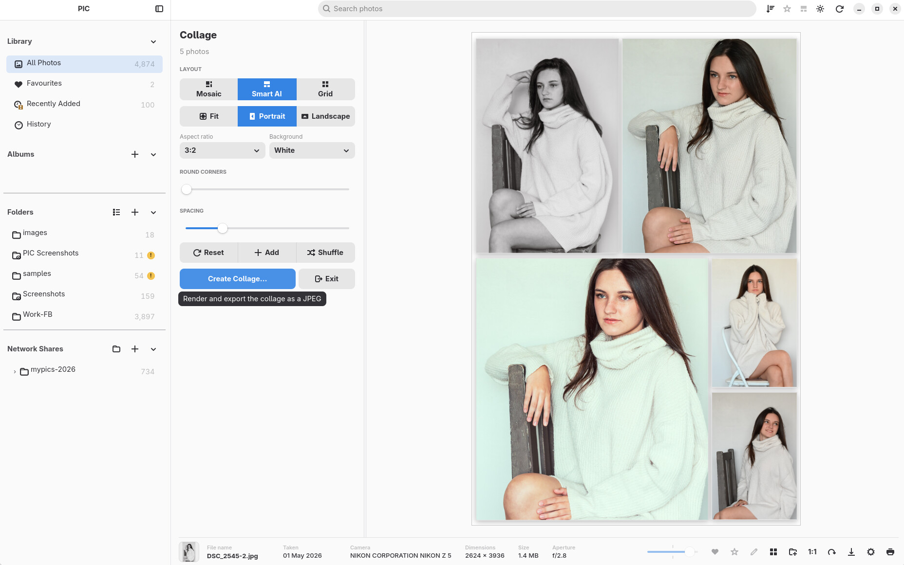

# PIC — Personal Image Catalogue

### The Picasa / classic iPhoto-inspired photo manager for Linux

**Browse, organise, edit and enjoy your photos — without moving your originals or relying on the cloud.**

[**Download the latest release**](https://github.com/froggy744/PIC/releases) · [Getting started](docs/guides/getting-started.md) · [Installation](docs/build/linux.md) · [Report an issue](https://github.com/froggy744/PIC/issues)


PIC is an independent, local-first photo manager built in **Rust, GTK4 and libadwaita**, with Fedora and Ubuntu as primary Linux targets. It brings the simplicity of classic photo organisers together with modern library browsing, practical editing, albums, collages and more.

> **Release status:** PIC is currently release-candidate software. [Read the RC4 release notes](docs/releases/rc4.md). Back up important photos and your PIC catalogue before testing.

## Why PIC?

- **Your photos stay yours.** PIC indexes photos where they already live; importing does not move or duplicate them.
- **Enjoy large collections.** Cached thumbnails, background work and Grid, Photo Wall and Masonry layouts make browsing comfortable.
- **Organise without duplicate files.** Use folders, albums, favourites, ratings, search and separate library databases.
- **Edit without changing originals.** Save adjustments as recipes and export finished images as new files.
- **Work locally or on your network.** Browse removable storage, camera cards, mounted folders, SMB and NFS shares.
- **Make something with your photos.** Create collages, print photos and use the viewer for close inspection.

## Explore PIC

### Browse the way you like

Switch between **Grid**, **Photo Wall** and **Masonry**. Resize thumbnails, hide the sidebar and move through your real folder tree. PIC remembers layouts for library sections.


### Keep your library organised

Browse **All Photos**, **Favourites**, **Recently Added** and **History**. Create albums, apply 1–5 star ratings and search photos or folders. Separate catalogue databases let you manage different collections.


### Make everyday edits

Adjust exposure, contrast, fill light, highlights, shadows, colour and sharpening. Crop, straighten, apply filters, add overlays or text, and use undo/redo. **Original photos remain untouched; export creates a new file.**


[Watch the short Edit Mode demonstration](screenshots/edit-mode.mp4)

### Create collages and print

Arrange selected photos into Grid, Mosaic or Smart Mosaic collages, adjust spacing and backgrounds, save projects and export high-resolution results. PIC also includes photo-printing layouts and previews.



### Browse local drives and network shares

Use existing folders, removable drives, camera/SD-card imports and **SMB/NFS** shares. Cached previews and offline indicators help you navigate collections even when a source is temporarily unavailable.


### Make it yours

Choose appearance themes, thumbnail options and display settings to suit your workflow.


## Download and install

**Linux is PIC's primary platform**, especially Fedora and Ubuntu. Releases and packaging options are available from the [GitHub Releases page](https://github.com/froggy744/PIC/releases). PIC provides Flatpak and AppImage packaging; availability and installation requirements depend on the release.

For build dependencies, Flatpak installation, optional AppImage builds and troubleshooting, see the [Linux installation guide](docs/build/linux.md).

To build a Flatpak bundle from a source checkout:

```bash
./scripts/PIC-build-linux-one-script.sh local --flatpak-only
```

To run a native development build after installing dependencies:

```bash
cargo run --release
```

Windows support is experimental.

## Supported photo formats

**Images:** JPEG, PNG, WebP, GIF, BMP, TIFF, AVIF, HEIC/HEIF.

**Camera RAW previews:** NEF, NRW, CR2, CR3, ARW, DNG, RAF, ORF, RW2, PEF, SRW and RAW.

RAW support is primarily for browsing and embedded previews, **not a replacement for a professional RAW development application**. JPEG ICC colour management is supported for valid embedded profiles in thumbnails and viewing; coverage varies by format.

## Get started

[Getting started](docs/guides/getting-started.md) · [Navigation and shortcuts](docs/guides/navigation.md) · [Folders and network shares](docs/guides/folders.md) · [Library and albums](docs/guides/library.md) · [Editing](docs/guides/edit-mode.md) · [Cropping](docs/guides/crop-mode.md)

Additional resources: [Themes](docs/THEMES.md) · [Linux build instructions](docs/build/linux.md) · [RC4 release notes](docs/releases/rc4.md) · [Development overview](docs/development/summary.md)

## Your originals and backups

PIC is designed for **non-destructive catalogue operations**: it references photos in their existing folders, stores albums, ratings and editing recipes in its own database, and exports edited images as separate files. Removing a photo or folder from the catalogue does not delete the original photo file.

**PIC is not a backup solution.** Bugs, filesystem failures and storage problems can still cause data loss. Keep independent backups of both your original photos and PIC's catalogue database, and test release-candidate builds with sample data before relying on them.

## Feedback and contributing

PIC began as a personal project to bring the enjoyable Picasa/iPhoto-style photo experience to Fedora and Ubuntu. Feedback, reproducible bug reports and contributions are welcome via [GitHub Issues](https://github.com/froggy744/PIC/issues).

When reporting a problem, include your Linux distribution, PIC release, what you did, what happened, whether the library is local or network-mounted, and relevant logs.

PIC is an independent open-source project and is **not affiliated with, endorsed by or sponsored by Google or Apple**.
