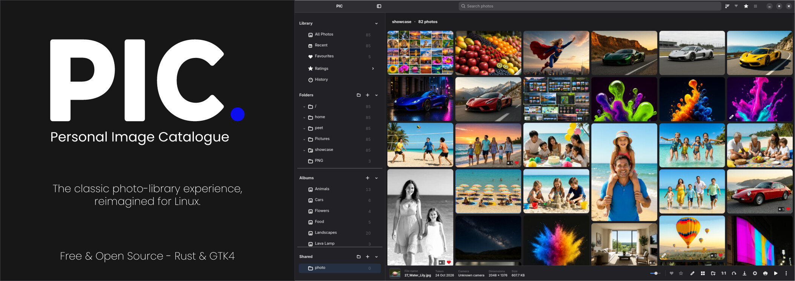
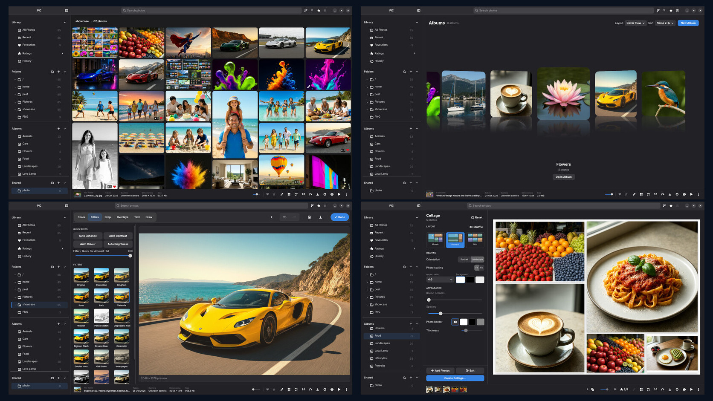
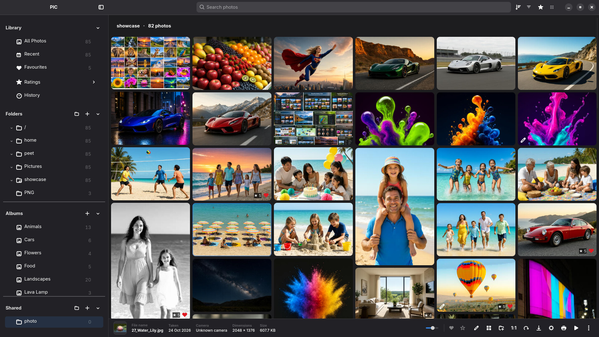
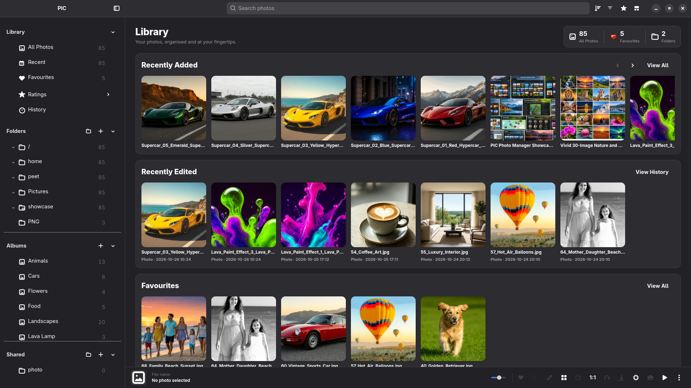

  

  <picture>
    <source media="(prefers-color-scheme: dark)" srcset="logo/logo-long-SVG.svg">
    
  </picture>
  <h3>Your photos. Your folders. Your way.</h3>
  
<strong>The classic photo-library experience, reimagined for Linux.</strong>

  
PIC (Personal Image Catalogue) is a free, open-source photo manager and editor for Linux. Browse and organise photos where they already live, make non-destructive edits, and create collages — all in a native Rust and GTK4/libadwaita app.

  
<strong>Local-first. No cloud account. No subscription.</strong> Your originals stay in their folders.

  
  
  
  
  

## Download PIC

**[Get the latest release](https://github.com/froggy744/PIC/releases/latest)** · [AppImage](https://github.com/froggy744/PIC/releases/download/V1.0.0/PIC-1.0.0-c82781221d-x86_64.AppImage) · [Flatpak](https://github.com/froggy744/PIC/releases/download/V1.0.0/PIC-1.0.0-c82781221d-x86_64.flatpak) · [Installation guide](docs/build/linux.md)

The latest published release is **V1.0.0**. Both packages above are attached to the [GitHub release](https://github.com/froggy744/PIC/releases/tag/V1.0.0). PIC is Linux-focused; Windows builds are experimental and are not a supported V1 download.

  

## A photo library made for browsing

- **Browse** — Grid, Photo Wall and Masonry layouts, plus a fullscreen viewer with zoom and navigation.
- **Organise** — Albums, favourites, star ratings, search, sorting, filters and multiple libraries.
- **Edit** — Exposure and colour adjustments, filters, crop and straighten, drawing, text and overlays. Recipes keep edits non-destructive; export makes a separate file.
- **Create** — Grid, Mosaic and Smart AI collages, screensavers, printing and export.
- **Make it yours** — Appearance themes, album covers, Bookshelf and Cover Flow layouts. The screensaver also offers a photo Cover Flow.

Import from folders and supported cameras or SD cards, and browse supported SMB/NFS network shares. PIC does not upload your collection to a cloud service. PIC is a photo manager, not a backup solution; keep separate backups of your original photographs.

## See PIC in action

Browse a colourful collection in Photo Wall:

  

The library dashboard brings recent photos, edits and favourites together:

  

Explore the [full screenshot gallery](docs/SHOWCASE.md) for albums, editing, collages, themes and more.

## Install

Download an [AppImage](https://github.com/froggy744/PIC/releases/download/V1.0.0/PIC-1.0.0-c82781221d-x86_64.AppImage) or [Flatpak](https://github.com/froggy744/PIC/releases/download/V1.0.0/PIC-1.0.0-c82781221d-x86_64.flatpak) from [GitHub Releases](https://github.com/froggy744/PIC/releases/latest). See [Linux installation guide](docs/build/linux.md) for setup details.

New to PIC? Start with the [getting started guide](docs/guides/getting-started.md) for first launch, import and browsing.

## Documentation

- [Getting started](docs/guides/getting-started.md) · [Navigation and viewer](docs/guides/navigation.md)
- [Library, albums and search](docs/guides/library.md) · [Folders and network shares](docs/guides/folders.md)
- [Edit Mode](docs/guides/edit-mode.md) · [Crop Mode](docs/guides/crop-mode.md)
- [Themes](docs/THEMES.md) · [All user guides](docs/README.md)
- [Complete visual showcase](docs/SHOWCASE.md) · [All screenshots and videos](screenshots/README.md)
- [Build from source and Linux packaging](docs/build/linux.md) · [Contributing](CONTRIBUTING.md) · [License](LICENSE)
- [Creator and press kit](docs/creator-kit.md) · [Linux installation guide](docs/build/linux.md)

## Contribute and connect

PIC is an independent open-source project inspired by classic Picasa and iPhoto. It is not affiliated with Google or Apple. Contributions, bug reports and ideas are welcome: [Contributing](CONTRIBUTING.md) · [Issues](https://github.com/froggy744/PIC/issues) · [Discussions](https://github.com/froggy744/PIC/discussions).
