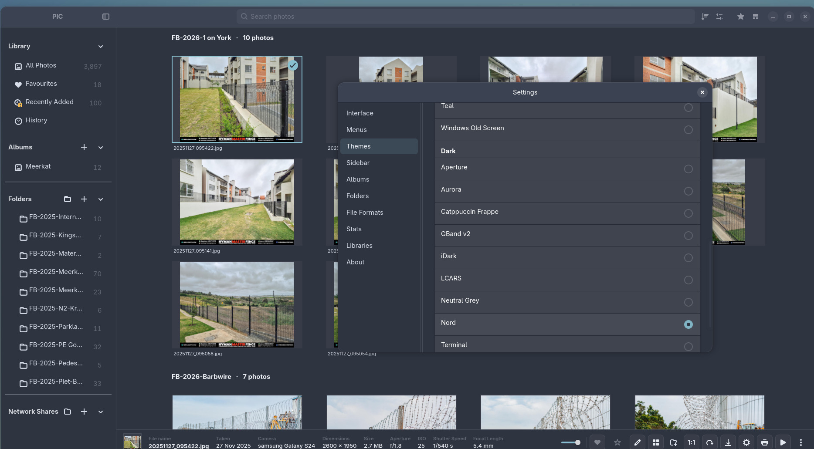

# PIC — Your photos. Your folders. Your way.

### The classic photo-library experience, reimagined for Linux.

**PIC (Personal Image Catalogue)** brings the joy of Picasa and classic iPhoto to a modern Linux desktop — with fast browsing, beautiful galleries, thoughtful organisation and creative tools, all in one native app.

**No cloud account. No subscription. No forced upload.** Your pictures stay in the folders you choose.

[**⬇ Download PIC V1**](https://github.com/froggy744/PIC/releases) · [Get started](docs/guides/getting-started.md) · [Explore the guides](docs/README.md) · [Report an issue](https://github.com/froggy744/PIC/issues)

> **PIC V1 is here.** Built for anyone who misses browsing and enjoying their own photo collection without having to hand it to a cloud service.

## Why PIC?

Your photo collection deserves more than a folder full of filenames. PIC turns existing photo folders into a library you can actually enjoy: find an old favourite, jump between albums, inspect a shot at full size, make a quick adjustment or put together a collage — without abandoning your originals.

| Discover | Organise | Create |
| :--- | :--- | :--- |
| **Grid, Photo Wall & Masonry** layouts | **Albums, favourites & 1–5 star ratings** | **Non-destructive edits & filters** |
| Fast cached previews and large-library browsing | Search, sort, group and filter photos | Crop, straighten, overlays and text |
| Full photo viewer, zoom and screensaver | Local folders, SD cards, cameras, SMB/NFS shares | Collages, print and export |

## Highlights

### Fall in love with browsing again
Move between **Grid**, proportion-aware **Photo Wall** and **Masonry**. PIC caches thumbnails for responsive browsing and offers a photo viewer with zoom, pan, ratings and fullscreen viewing.

### A home for every collection
Keep your existing folder structure. Build albums without duplicating photos, mark favourites, rate your best shots and search the catalogue. **Multiple library databases** let you switch between collections or projects.

### Bring your photos together
Import from folders and supported cameras or SD cards; browse **SMB and NFS** shares. Cached thumbnails can remain visible when a drive is offline; full-resolution actions need the originals connected.

### Create without sacrificing originals
Adjust light and colour, apply filters, crop and straighten, add overlays or text, and use Undo/Redo. PIC stores edits as **non-destructive recipes**; export creates a separate finished image. Compose **Grid, Mosaic and Smart AI** collages and enjoy your photos with the built-in screensaver.

### Make it yours
Choose from appearance themes, customise the gallery, and explore album covers and bookshelf-style album presentation. PIC is built with **Rust + GTK4/libadwaita** for Linux.

[Watch the V1 walkthrough](screenshots/screenshots-V1/walkthrough-V1.mp4) · [2× version for Reddit](screenshots/screenshots-V1/walkthrough-V1-reddit-2x.mp4) · [All V1 screenshots](screenshots/README.md)

## Install PIC

**Linux:** Download the latest **Flatpak** or **AppImage** from [GitHub Releases](https://github.com/froggy744/PIC/releases). Flatpak is the recommended cross-distribution option; AppImage compatibility depends on the host. Follow the [Linux installation guide](docs/build/linux.md) for requirements and troubleshooting.

**Windows:** Experimental, not a supported V1 download target.

PIC is local-first. The app does not require a cloud account; network-share browsing and downloading packages naturally require a network connection.

## Start exploring

| I want to… | Read |
| --- | --- |
| Install PIC and import my first photos | [Getting started](docs/guides/getting-started.md) |
| Navigate, view, zoom and select photos | [Navigation](docs/guides/navigation.md) |
| Import or manage folders and network shares | [Folders and network shares](docs/guides/folders.md) |
| Organise albums, rate, search and switch libraries | [Library and albums](docs/guides/library.md) |
| Edit a photo without changing the original | [Edit Mode](docs/guides/edit-mode.md) |
| Crop and straighten | [Crop Mode](docs/guides/crop-mode.md) |
| Explore appearance themes | [Themes](docs/THEMES.md) |
| Cover PIC in a video, article or post | [Creator & press kit](docs/creator-kit.md) |
| Find all guides | [Documentation index](docs/README.md) |

## For reviewers, creators & the Linux community

**Looking for a compelling Linux app to show your audience?** PIC combines a nostalgic photo-library feel with modern offline-first workflows. Great demo moments include switching gallery layouts, browsing bookshelf albums, opening a full-screen shot, rating photos, applying a non-destructive edit and building a collage.

Find a ready-to-use summary, demonstration outline, suggested talking points, image slots and accurate product details in the **[PIC creator & press kit](docs/creator-kit.md)**.

**Share your experience:** [Discussions](https://github.com/froggy744/PIC/discussions) · [Issues and feedback](https://github.com/froggy744/PIC/issues) · [Releases](https://github.com/froggy744/PIC/releases)

---

**Important:** PIC is a photo manager, **not a backup solution**. Back up your original photos separately; a PIC database backup preserves catalogue data and edit recipes, not the original photographs.

PIC is an independent open-source project inspired by classic Picasa and iPhoto experiences; it is **not affiliated with Google or Apple**.
