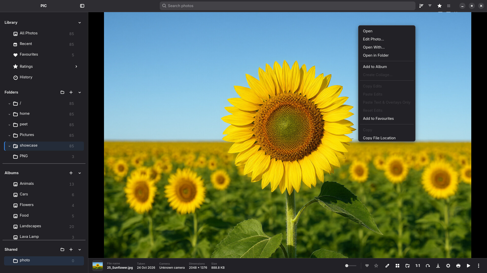
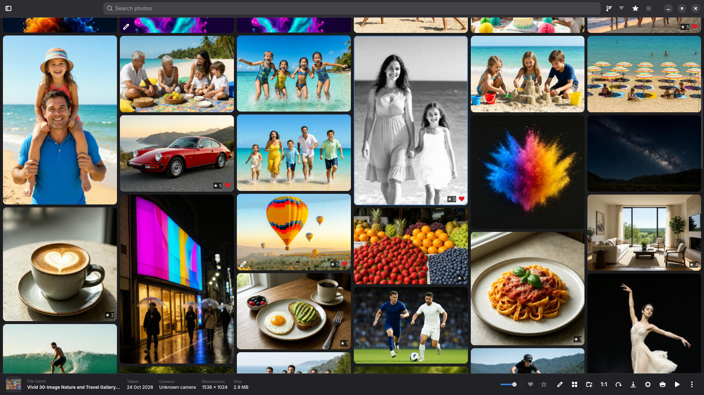
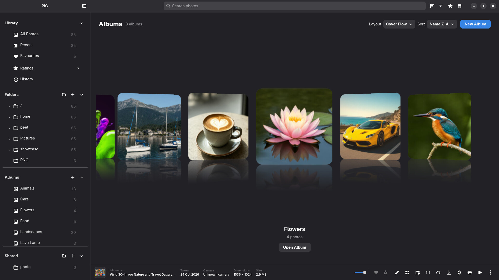
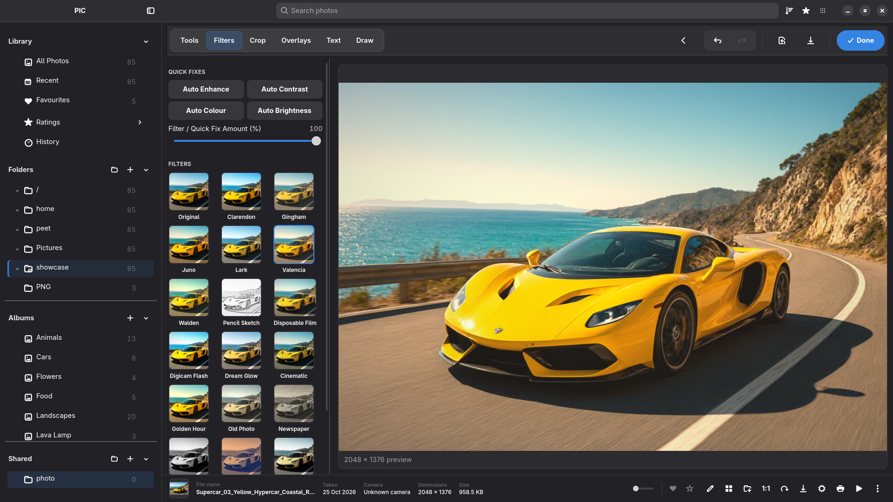
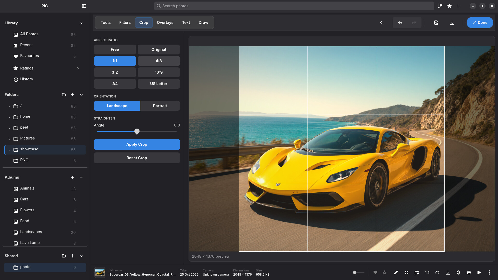
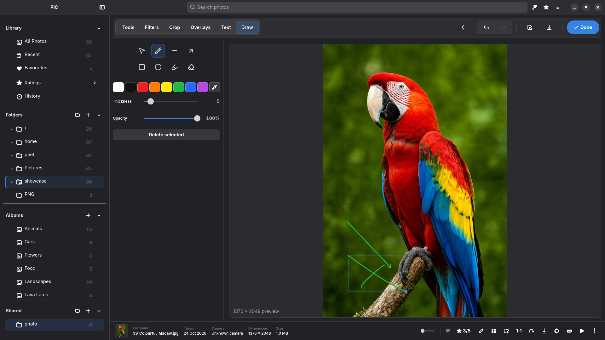
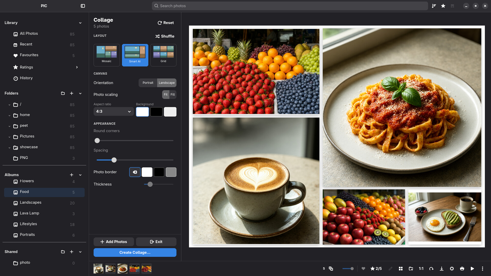
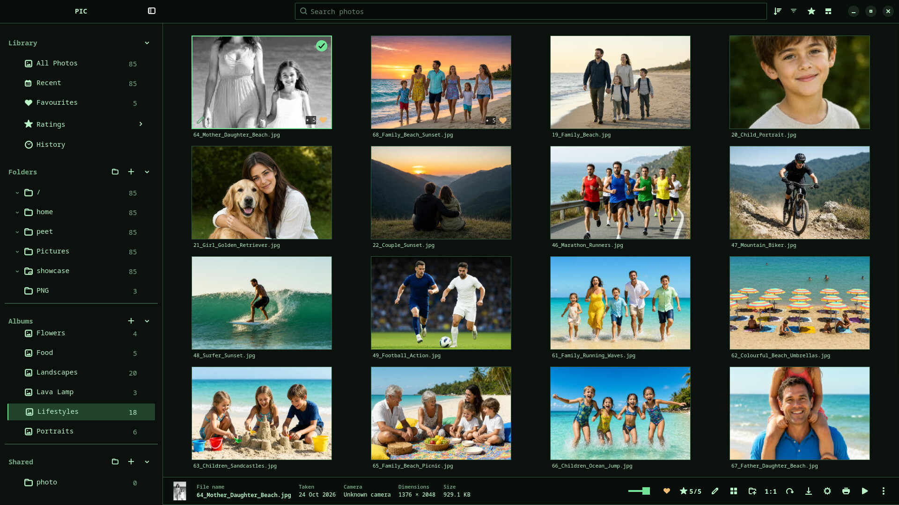
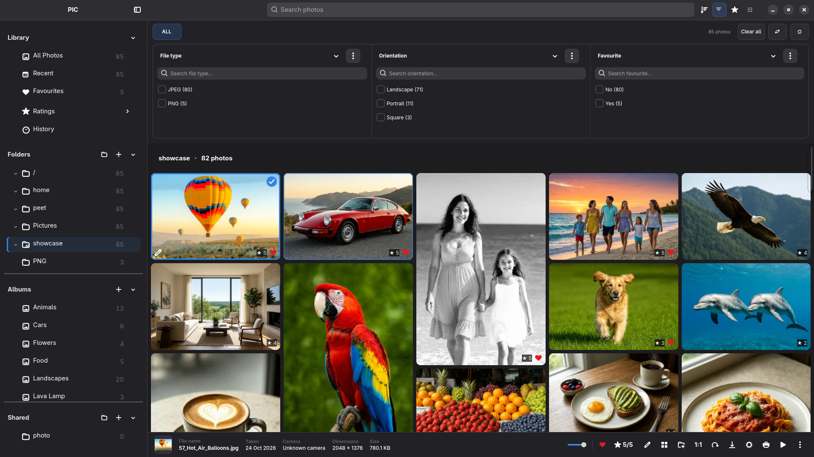

# PIC — Visual showcase

A tour of PIC's actual Linux interface, captured from the V1.01 demo library. The gallery uses the new colourful photo set throughout; one earlier V1 capture is included for network-share browsing, which is not shown in the new set.

[Download PIC](https://github.com/froggy744/PIC/releases/latest) · [Getting started](guides/getting-started.md) · [Back to the main README](../README.md)

## Photo browsing

Browse the library in Photo Wall and open a photograph in the fullscreen viewer. The viewer supports zoom and navigation while keeping the library close at hand.

  

  

  

**Highlights:** Grid, Photo Wall and Masonry layouts · Fullscreen viewing · Zoom and navigation · Optional sidebar visibility

## Albums and Cover Flow

Group photos into albums without moving or duplicating the originals. Switch the Albums page to its Cover Flow layout for a horizontal, reflective presentation.

  

**Highlights:** Album covers · Cover Flow · Bookshelf presentation · Favourites and star ratings

## Editing tools

Adjust a photo while leaving its source file untouched. PIC stores changes as an edit recipe; export creates a separate finished image.

  

  

  

**Highlights:** Exposure and colour adjustments · Filters · Crop and straighten · Text, overlays and drawing · Undo and redo

Read the [Edit Mode guide](guides/edit-mode.md) and [Crop Mode guide](guides/crop-mode.md).

## Collages

Combine selected photos in the collage workspace, adjust the arrangement and appearance, then create a JPEG or save the project to resume later.

  

**Highlights:** Grid, Mosaic and Smart AI layouts · Portrait and landscape orientation · Spacing, background and corner options

## Themes

Personalise the gallery with appearance themes. The Terminal theme also unlocks Matrix Rain and Matrix Ken Burns screensaver styles.

  

**Highlights:** Light, dark and expressive themes · Configurable album and bookshelf artwork · Terminal theme extras

See [Themes and customisation](THEMES.md).

## Screensavers

Turn a photo collection into a desktop presentation with several built-in layouts and transitions. The new V1.01 capture shows a six-photo screensaver composition.

  

**Highlights:** Mosaic, grid, picture pile and other styles · Configurable timing · Optional Matrix Rain and Matrix Ken Burns

## Import and organisation

Bring existing folders into a library, manage multiple collections and browse supported network shares. PIC references files in place and stores catalogue information separately.

  

  

  

**Highlights:** Folder browsing · Supported SMB and NFS shares · Albums and ratings · Search and filtering · Multiple library databases

See [Folders and network shares](guides/folders.md), [Library and albums](guides/library.md), and [Getting started](guides/getting-started.md).

---

The [V1.01 screenshots](../screenshots/v1.01/) are full-size 1920 × 1080 JPG captures. Browse the [complete V1 screenshot archive and walkthrough videos](../screenshots/README.md), or return to the [main README](../README.md).
