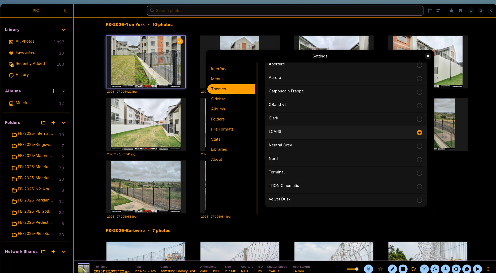

# PIC V1.0.0 — Your photos. Your folders. Your way.

> **Release draft:** final build availability is still pending.

**The classic photo-library experience, reimagined for Linux.**

Miss Picasa or classic iPhoto? Meet **PIC (Personal Image Catalogue)**: a free, open-source, local-first photo manager built with Rust, GTK4 and libadwaita. Browse, organise, edit and enjoy your photo collection — **without a mandatory cloud account, subscription or upload**.

PIC V1 marks the move beyond our release-candidate series. Thank you to everyone who tested, reported issues and helped shape the experience.

## ✨ Highlights

### Rediscover photo browsing
- **Three gallery styles:** Grid, Photo Wall and Masonry.
- Fast cached thumbnails for browsing large libraries.
- Photo viewer with full-screen viewing, zoom, pan and navigation.
- Customisable appearance themes and a built-in photo screensaver.

### Organise everything in one place
- Albums, favourites, **1–5 star ratings**, search, sorting and rating filters.
- Album covers and bookshelf-style album browsing.
- Import existing folders, supported camera/SD-card photos and browse **SMB/NFS** network shares.
- Keep multiple separate photo-library databases and switch between them.
- Cached thumbnails can remain visible when external storage is disconnected.

### Edit and create, without damaging originals
- Non-destructive photo adjustments, filters, crop and straightening.
- Exposure and colour tools, creative effects, overlays and text.
- Undo, Redo and Reset; **export creates a new image** instead of replacing the original.
- Create collages with Grid, Mosaic and Smart AI layouts; adjust backgrounds, spacing, corners and borders.
- Print your photos and enjoy them as a screensaver.

### Polished for V1
- Refined InfoBar and selection controls, photo actions, menus, toolbars and navigation.
- Improved gallery layout behaviour, thumbnail handling and editing responsiveness.
- Expanded appearance and album presentation options.
- Rust compiler-warning cleanup and ongoing regression testing.

## 📦 Downloads — Linux

Choose the **Flatpak** or **AppImage** asset attached to this release **once the final builds are available**.

- **Flatpak:** recommended for portability across supported Linux distributions.
- **AppImage:** convenient standalone package; compatibility depends on host libraries and system requirements.
- **Windows:** experimental and not an officially supported V1 release target.

See the [installation guide](../build/linux.md) and [getting started guide](../guides/getting-started.md). Please report installation problems with your Linux distribution and package type.

## 📸 V1 screenshots and walkthrough

[Full V1 media gallery](../../screenshots/README.md) · [Walkthrough MP4](../../screenshots/screenshots-V1/walkthrough-V1.mp4) · [2× Reddit MP4](../../screenshots/screenshots-V1/walkthrough-V1-reddit-2x.mp4)

## ❤️ Help shape PIC

PIC is an independent open-source project. If you enjoy it, please **star the repository, share it with another Linux photo enthusiast, or show it in a video or article**.

- [Source and project README](https://github.com/froggy744/PIC)
- [Documentation](../README.md)
- [Creator and press kit](../creator-kit.md)
- [Report a bug or request a feature](https://github.com/froggy744/PIC/issues)

**Please back up your original photos separately.** PIC is not a backup solution. Library-database backups protect catalogue information and saved edits, not the image files themselves.

*Inspired by Picasa and classic iPhoto; not affiliated with Google or Apple.*
