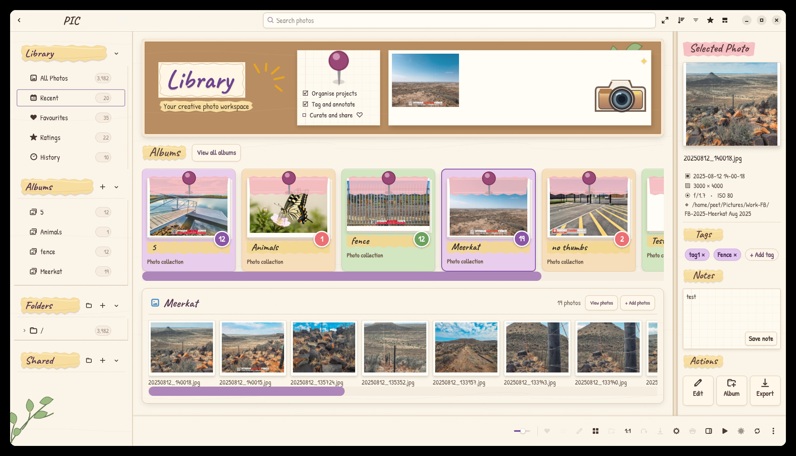
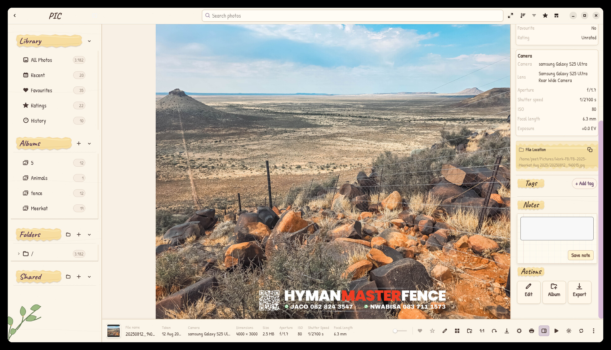
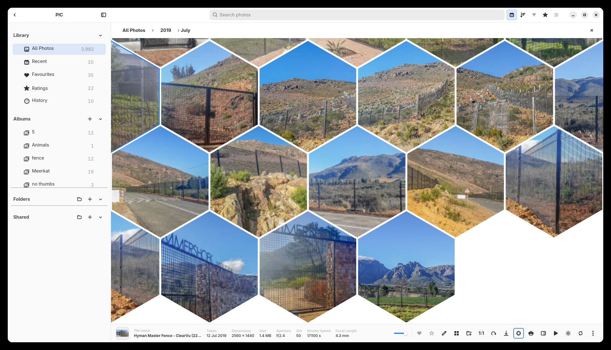
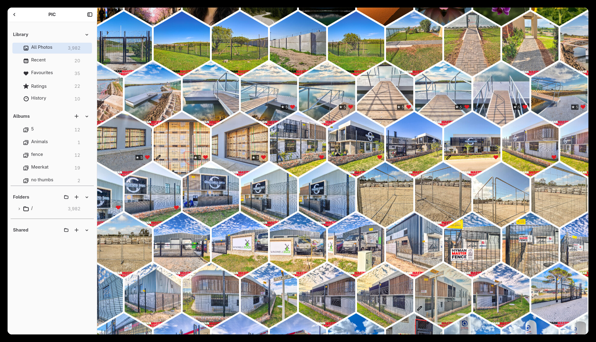
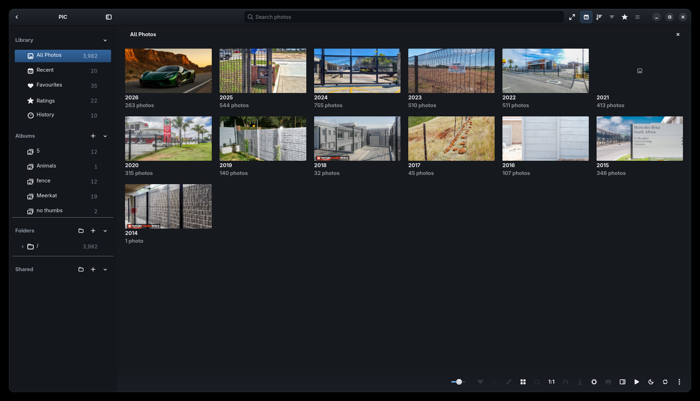
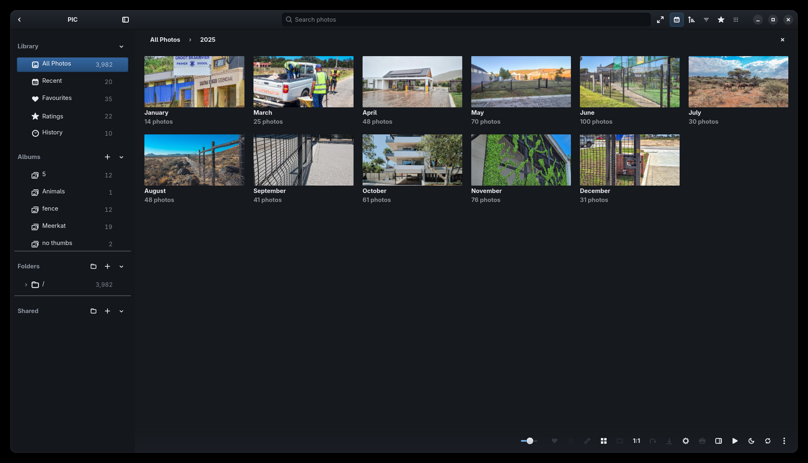

# PIC v1.0.3 release notes — draft

This release focuses on performance, photographic quality, and reliability.

## New features and improvements

- Add a visual calendar browser to All Photos with year and month tiles, representative covers, counts, Unknown Date browsing, breadcrumbs, and direct access to the normal photo layouts and viewer.
- Keep calendar browsing connected to the existing sort and zoom controls; synchronize selection and InfoBar state across calendar levels, navigation, and return to the photo grid.
- Add the PIC Scrapbook theme, a complete illustrated paper-and-Polaroid treatment with bundled handwritten fonts, decorative details, and a purpose-built Library dashboard.
- Build the Scrapbook Library around real albums and photos: browse albums on a horizontal shelf, inspect the selected photo beside the library, and manage photos without leaving the dashboard.
- Give each photo persistent Scrapbook tags and notes, plus direct Edit, Add to Album, and Export actions. Create albums in place and add photos through a searchable, paged multi-select picker with thumbnail previews.
- Add Honeycomb as a fourth photo layout alongside Grid, Photo Wall, and Masonry. Its virtualized hexagonal gallery keeps thumbnails, selection, navigation and the InfoBar connected to the existing photo workflow.
- Add Immersive Mode for an expanded photo canvas, with top and bottom chrome revealed on demand and a left navigation sidebar that slides over the gallery. It supports expanded and compact sidebar styles, edge reveal, and I/Escape keyboard controls while preserving the gallery viewport and the normal sidebar settings.
- Add editable photo tags to the standard Properties inspector and global metadata filters, including multi-tag filtering, facets, and reusable tag suggestions.
- Add Photo Drift and Flying Photos screensavers, with background controls, tile-count settings, Matrix styles, and the Surprise presentation option.
- Improve the InfoBar with bounded multi-selection previews and actions, responsive metadata, clearer empty-selection behavior, and thumbnail updates as previews become available.
- Improve gallery thumbnail sizing and quality choices, retain loaded thumbnails while scrollbar scrubbing settles, and smooth scroll and keyboard-centering behavior across layouts.
- Improve sidebar navigation, destination counts, quick-filter controls, pinned filters, and filter styling.
- Refine photo controls, metadata presentation, Properties panel layout, and theme contrast and corner details.
- Invalidate stale cached viewer previews when source files change, and strengthen detection of changed photos during authorized refreshes.

- Prevent the lightbox from reusing a fit-sized or 1:1 cached image when the indexed source modification time or size has changed.
- Defer thumbnail-cache recovery until the saved gallery view is restored, bringing first paint and first-thumbnail display forward in the isolated large-library comparison without changing scan authorization or recovery behavior.
- On a manually scrolled, isolated 8,756-photo library using native Wayland and an AMD RX 7600, GTK after-paint intervals measured 13.410 ms median, 21.266 ms p95, and 34.940 ms p99; 12 of 932 intervals exceeded 33.3 ms, with a 51.809 ms maximum. These are GTK frame-clock intervals, not physical display presentation times; occasional long intervals remain unexplained.
- Native startup across 10 runs per cache state measured 1,271 ms median to first window after-paint and 1,561 ms to first mapped thumbnail with an empty PIC thumbnail cache; warm-cache medians were 288 ms and 414 ms. OS storage caches were uncontrolled.
- On a real 50 MP DNG, the RX 7600 GPU regression verified neutral-source sharpness and CPU/GPU adjustment parity; warm preview changes reused one source upload. The orientation-1 and orientation-6 RAW export fidelity tests verified viewer/export agreement and unchanged source bytes.
- Cached viewer selection to first after-paint measured 13.207 ms median, 20.517 ms p95, and 27.310 ms maximum across 50 in-memory texture-cache samples. This is an internal synthetic-texture probe, not real-photo input-to-display timing.

## Screenshots

The following captures show the new calendar browser, the Scrapbook Library and its photo notes/tags, Honeycomb, and Immersive Mode with both sidebar styles. The JPGs are collected in [`screenshots/v1.03/`](../../screenshots/v1.03/).

### Scrapbook theme

The Scrapbook Library pairs a corkboard-style dashboard and Polaroid album shelf with a real photo strip and a selected-photo inspector. Tags and notes persist with the library, and the inspector keeps editing, album, and export actions close to the selected photo.

### Honeycomb view

Honeycomb presents the photo collection as a virtualized field of hexagonal thumbnails, while retaining PIC's normal selection, InfoBar, and photo navigation.

### Immersive Mode

Immersive Mode gives the gallery more room by hiding its chrome until needed. The navigation sidebar can slide over the gallery, and the compact sidebar remains available as an overlay option.

### Calendar browser

Browse All Photos by year and month, then return to the regular photo layouts or open a photo in the viewer.

These are development results with the limitations documented in [the v1.0.3 checklist](v1.0.3-checklist.md). Before release sign-off, complete the available GUI suite and AppImage artifact smoke on a host with working AT-SPI and bundled SVG-loader dependencies. Actual library-switch timing, physical real-RAW slider-to-painted-frame timing, true stalled-mount behavior, and broader visual colour review remain open or environment-dependent. This draft is not a published release note.
