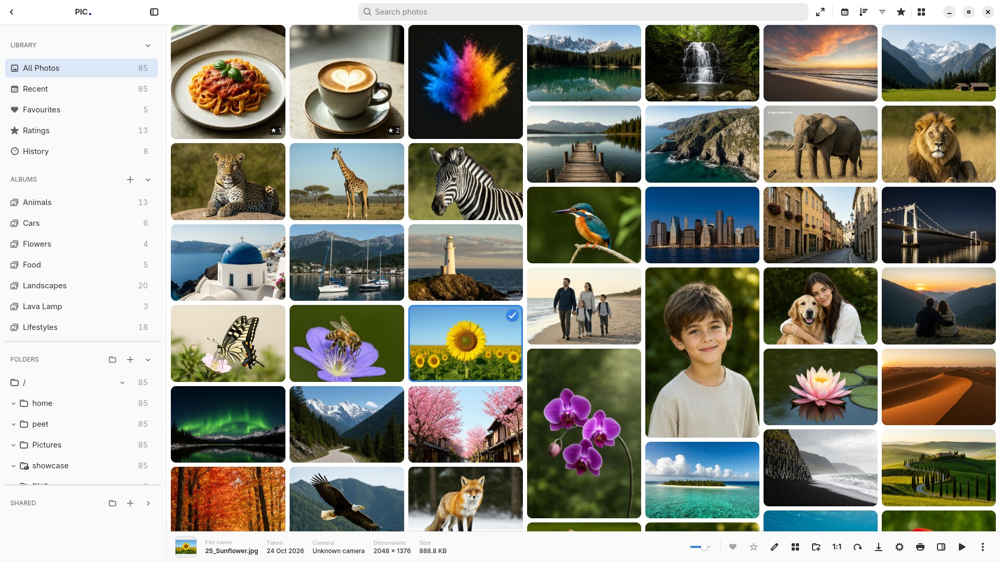

# PIC v1.0.4 release notes

This release focuses on how browsing feels: smoother scrolling, thumbnails that keep up with it, a gallery that comes back where you left it, and windows that stay usable when narrow. PIC can now also open, edit, copy and print photos that are not in the library, straight from the file manager or by dragging them onto the window.

## New features and improvements

- Open photos from the file manager with "Open With PIC", which used to do nothing. One photo opens in the viewer among the other photos in its folder, several open as that set, and a folder opens its photos. Photos already in the library open as themselves; other files open as photos outside the library, without being added to it. This works whether PIC is closed or already running, and the deb and rpm launchers now register PIC for image files like the Flatpak and AppImage do.
- Drag photos or a folder onto the PIC window to open them in the viewer, the same way as "Open With PIC" (#249). Drops are refused while the editor or a collage is open, so work in progress is never covered, and images dragged from a web browser without a local file are ignored.
- Edit photos opened from outside the library, for quick fixes such as cropping a screenshot. Save Copy writes the edited photo as `<name>_edit` next to the original (PNG and WebP keep their format, others are saved as JPEG) and never overwrites anything; the original is untouched and nothing is added to the library. Leaving with unsaved edits asks before discarding them.
- Copy and Print in the photo context menu now work. Copy puts the photo, with its edits applied, on the clipboard as a PNG; Print opens the same print flow as the InfoBar for the selected photos. Both also work for photos outside the library.
- Copy a photo from the editor as a single compressed PNG, so large screenshots stay within chat apps' size limits.
- Show only the actions that work in the context menu of a photo outside the library: library-only actions such as Add to Album, Favourite, Rename and Delete are hidden, and Export now works for it.
- Refine the sidebar: headings, icons and photo counts line up in columns, rows are spaced like GNOME Files, and the navigation styling is softer.
- Separate the top toolbar's groups of tools with dividers.
- Add the round blue dot from the PIC logo after "PIC" in the header, in both the normal and compact sidebar (#248).
- Glide mouse-wheel scrolling in All Photos and Folders to an exact stop, like a web browser: each wheel click eases in, slows evenly and stops on time, with no slow crawl at the end. A click during a glide keeps its speed; reversing direction starts from rest.
- Give the gallery scrollbar a browser-style handle: hidden while idle, a slim line while scrolling, and a wider handle on a faint track when the pointer reaches it, so it is easy to grab. Its colours follow the active theme.
- Come back to where you left a library: switching to another library and back now restores the gallery position, as a restart already did.
- Restore the gallery position exactly on restart. All Photos used to come back about one row off when the sidebar took its width after the restore, and Folders up to a tile off when the remembered photo was focused.
- Save the library's view, scroll position, window size and sidebar width when you switch libraries, not only when PIC closes.
- Load thumbnails for the part of a folder that is actually on screen first, size them to the tile, and keep showing them during fast scrollbar drags in Folders.
- Fold the header tools (date browser, sort, filters, rating filter, photo view) and then the InfoBar buttons into menus as the window narrows, so the normal window can shrink as far as Immersive Mode without cutting controls off.
- Animate the sidebar slides in and out even when the desktop's animations are turned off; they are part of PIC's layout.

## Fixes

- Remove Move from the photo context menu; it was never implemented.
- Fix the AppImage showing only a Close button on GNOME: it now bundles GLib's dconf settings backend, so it follows the desktop's title-bar button layout (minimize, maximize) and other desktop settings again.
- Fix clicks and hover on gallery tiles being ignored for a moment while the view was still settling after a scroll, which often made opening a photo take several clicks.
- Stop tiles in All Photos and Folders from following the pointer while scrolling.
- Redraw only the rotated photo's tile on Rotate, instead of blanking the whole gallery while it reloads.
- Update only the parts of the InfoBar that changed when moving between photos.
- Save favourites for a multi-photo selection in one step, so the selection is marked all at once or not at all.
- Fit the compact Immersive header inside its overlay.
- Keep the sidebar pin state after starting in the compact sidebar.

## Under the hood

Most of this release is a restructuring of the window code so that each part of the screen has one owner: the sidebar, the Properties inspector, the InfoBar, which surface is in front (gallery, viewer, editor or date overview), the zoom slider, favourites and ratings, the current photo, the saved window session, gallery scroll motion, and the screensaver styles. Each has a small tested module and a guard script (`scripts/check-presentation-owners.sh`) that stops other code from writing its widgets directly. Nothing about how these look should change; the aim is fewer regressions when they are touched.

Testing grew with it: about 1,000 unit tests, scripted interaction checks for the viewer, editor and date overview (`scripts/front-surface-checks/`) and for library switching, Exit and restart (`scripts/library-switch-checks/`), and a GUI harness that drives buttons by their accessible names instead of screen positions.
