# PIC v1.0.5 release notes

PIC v1.0.5 is the biggest release yet: more than 200 changes since v1.0.4. It brings **Smart Albums**, **Focus mode**, a redesigned **photo editor** with layers for text, overlays and drawings, a new **Properties panel**, **quick library switching**, a customisable **InfoBar**, smarter **search**, one **render pipeline** shared by every view and export (faster and more accurate, especially for Nikon RAW), and a long list of fixes. Under the hood, most of the window code has been rebuilt so that each part of the screen has one owner.

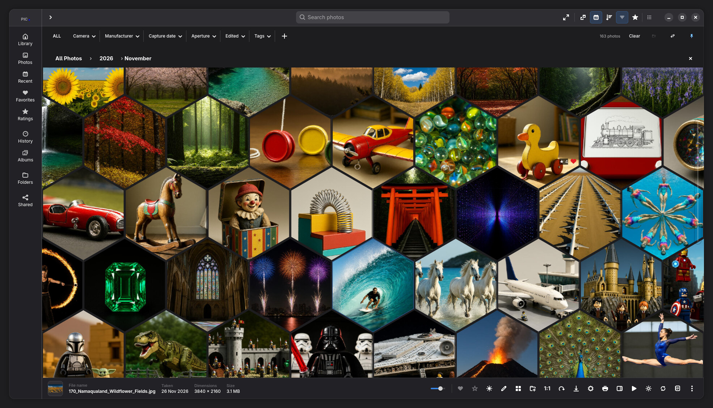

## Smart Albums

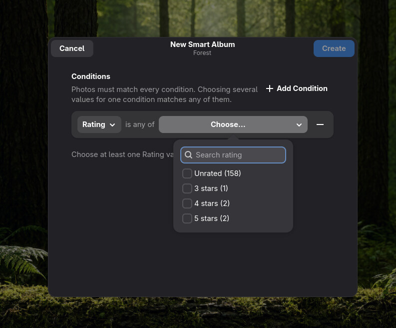

- **Smart Albums**: albums whose photos are chosen by rules (camera, manufacturer, capture date, aperture, ISO, edited, tags, rating, favourite and more) instead of being added by hand. They stay up to date as photos are rated, tagged, edited, rotated, imported or deleted.
- **Save as Smart Album…** from the metadata filter row turns the filters you are browsing with (including the rating filter) into a Smart Album to name and review.
- **One New Album dialog** everywhere, with an Album / Smart Album choice. Smart Album opens a native rules dialog with one row per condition, only the comparisons each field supports, and a live count of matching photos.
- **Edit Rules…** in the sidebar and album card menus changes a Smart Album's rules in place, keeping its name, cover and layout.
- Smart Albums sit in the same Albums sidebar section and Albums overview as manual albums, with their own icon. The overview gains a **Type** filter (All types, Albums, Smart Albums), saved per library.
- Smart Albums are read-only photo sources: they never appear as Add to Album destinations, and Remove from Album is not offered inside one.

## Albums everywhere

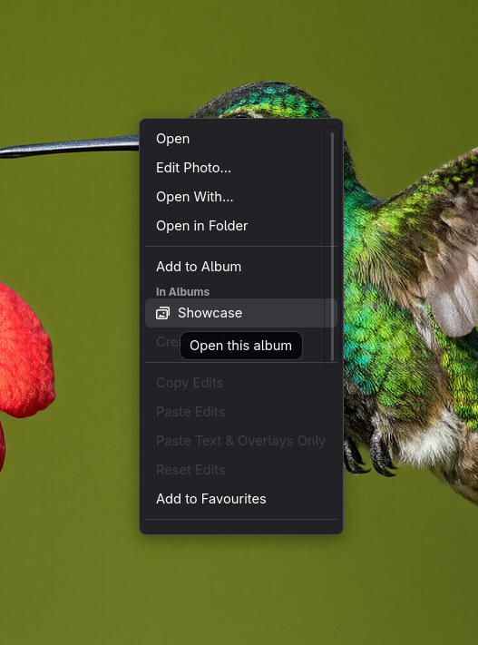

- **In Albums**: the photo menu lists the albums and Smart Albums a photo is in; click one to open it (#267).
- **One Add to Album list** for the InfoBar, the photo menu (now a popover beside the row instead of a separate dialog), Scrapbook and Properties. It is rebuilt each time it opens, so it always lists the open library's albums.
- **Add to album** in Properties, beside Add tag (#266).

## Properties panel, redesigned

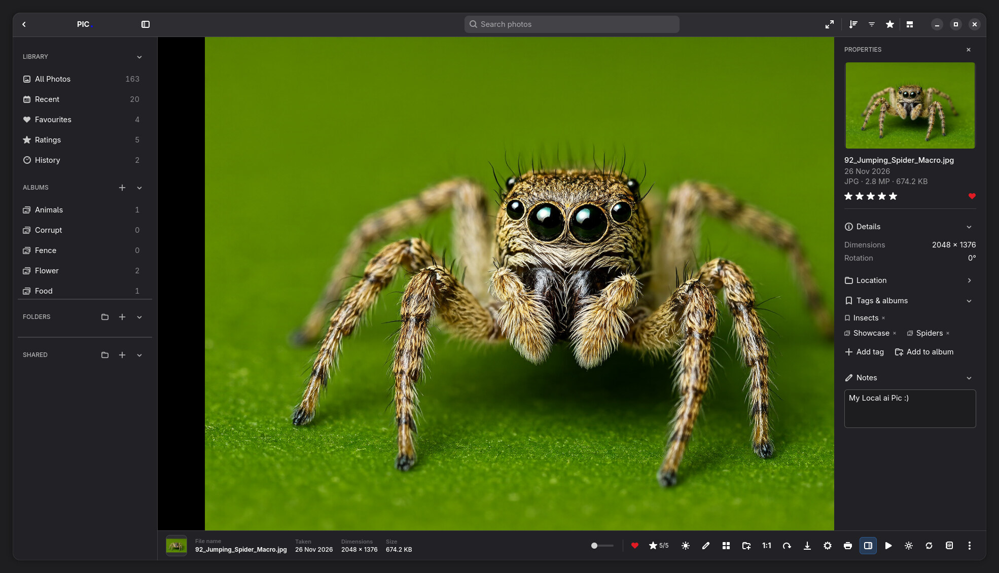

- Rebuilt on the sidebar's design: a header with close, a rounded preview, a summary (name, date, type, megapixels, size, stars and favourite), the camera block, then collapsible **Details**, **Location**, **Tags & albums** and **Notes** sections. Which sections are open is remembered per library.
- **Tags & albums** shows the photo's tags and the albums and Smart Albums it is in as flat, wrapping items with tiny icons. Click an album to open it; the small × removes a tag, or takes the photo out of a manual album. Everything works from the keyboard.
- Camera names show the brand once ("Nikon Z 5").
- **Save note** appears only when the note has changed, and the notes box follows the theme in light and dark.
- Rotating in the viewer now refreshes the viewer's Properties panel instead of the gallery's.

## Focus mode

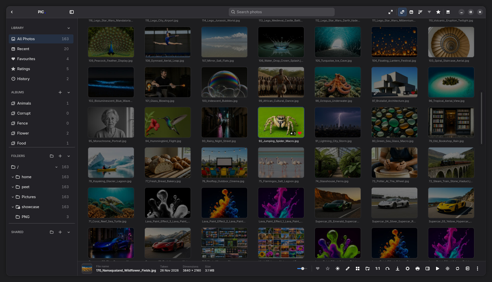

- A new toggle in All Photos dims every photo except the one under the pointer or the selected one, so a single frame stands out while you cull a burst.
- Arrow keys and clicks move the lit photo, and the last photo stays lit across the gaps between tiles.
- Works in every layout, including Honeycomb's hexagons, in light and dark themes. It fades smoothly, and the setting is saved per library.

## Photo editor

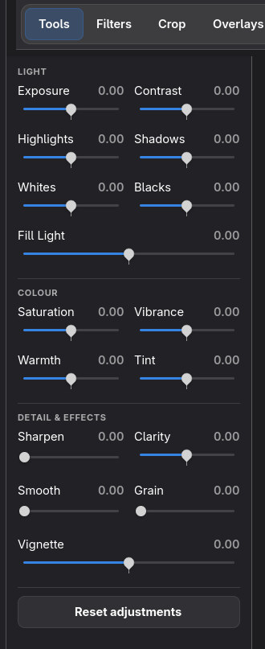

- **New panel layouts** for Tools, Filters, Crop, Overlays, Text and Draw: grouped sections, flat neutral buttons in every theme, and no grey cards.
- **Tools** lays out sliders two per row under Light, Colour and Detail & Effects, with signed values. **Reset adjustments** returns every slider to neutral in one undo step, leaving filters, crop and layers alone.
- **Filters** gets an **Intensity** slider shown as a percentage.
- **Crop**: aspect presets in rows of three, Landscape/Portrait as a pair, a Straighten slider in degrees, and Reset beside Apply. Drag inside a crop selection to move it.

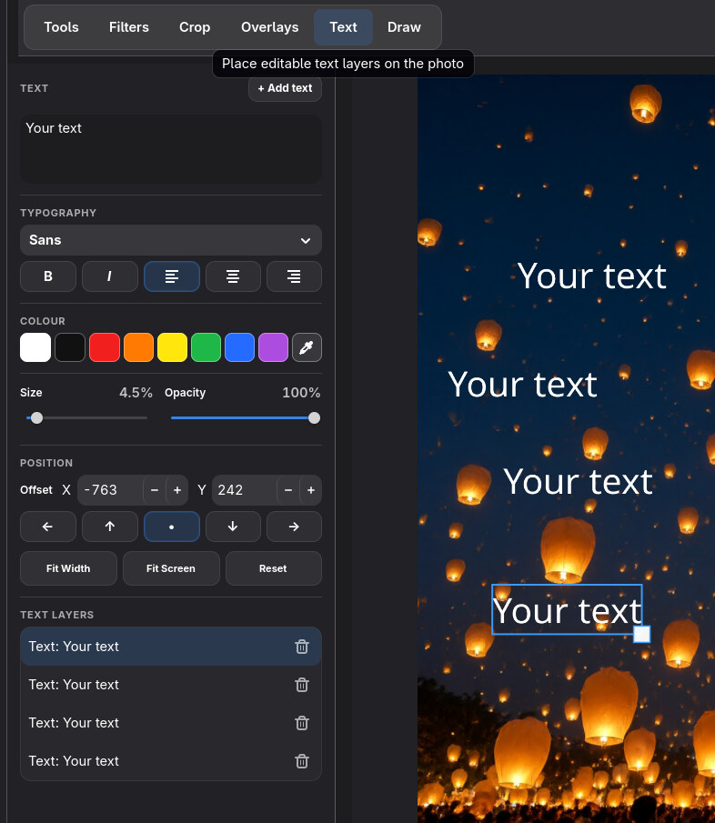

- **Text** has typography, colour, size and opacity, an Offset X/Y row with five placement buttons, Fit Width / Fit Screen / Reset, and a **Text Layers** list with a trash button per row.
- **Overlays** has an Appearance section and the same position controls and per-row trash.

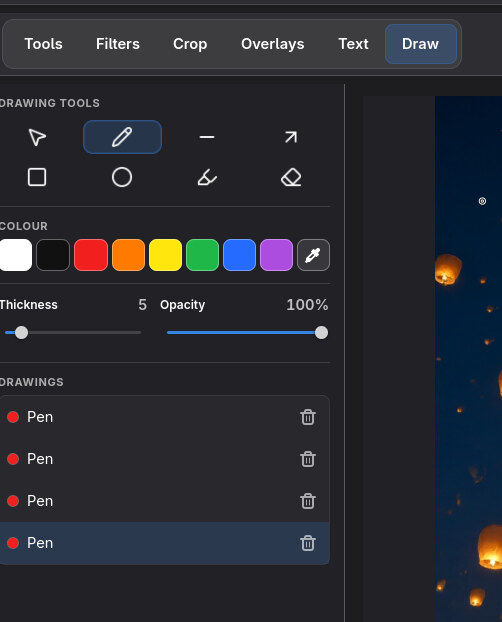

- **Draw** gets a **Drawings** list: one row per drawing with its colour and shape and its own trash button. Selecting a row selects that drawing. Draw now opens on the pen, ready to draw, and no longer squeezes the panel.
- **Select any layer from any tab**: clicking text, an overlay or a drawing on the photo opens its tab with it selected.
- **Undo, Redo, Reset, Export and Copy** sit in their own strip, with Close and Done as a matching pair.
- **Smooth transitions**: the editor fades in from the viewer or the gallery on the image already on screen and sharpens in place, then fades out again on Back, Done or Escape. No more hard cut to an empty canvas.
- **Faster opening**: the full-resolution decode and colour conversion now run in parallel (24 MP ICC conversion about 150 ms → 33 ms).
- **The editor returns a library photo to the viewer** it was opened from, instead of the gallery.

## InfoBar

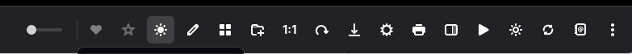

- **Draw button**: opens the editor straight on its Draw tab (#258). Edit has a new brightness icon.
- **Libraries button**: one click lists every library and switches to it (#254). **Manage Libraries…** opens the Settings page.

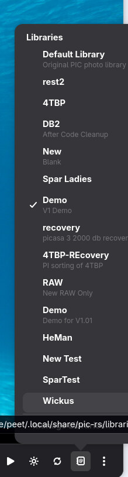

- **Order the InfoBar buttons yourself**: every entry in **Show in InfoBar** has Move up and Move down. The bar, and the automatic layout on narrow windows, follow your order (#250). The zoom control is now labelled Zoom.

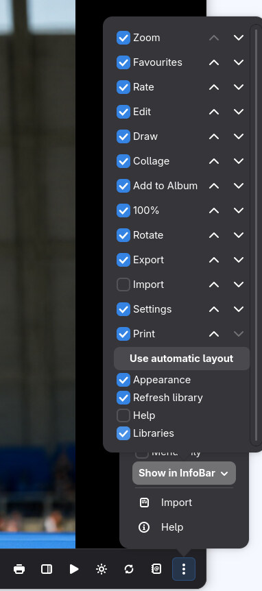

- Metadata the photo does not have is hidden instead of shown as "Unknown" (#269).
- The rating count ("3/5") is smaller and matches the other InfoBar text (#260).

## Search, filters and browsing

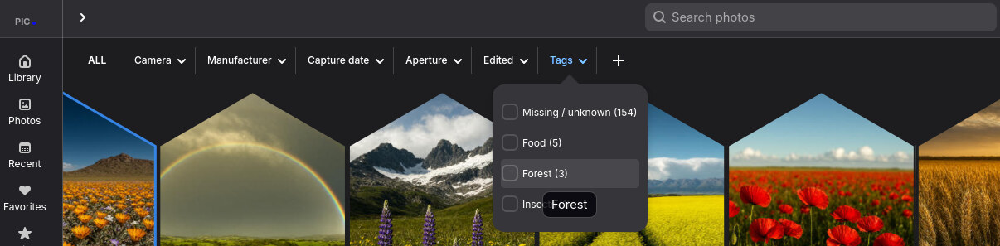

- **Search by capture date and album name** as well as file path. Written dates such as "May 2023", "14 May 2023" and "14/05/2023" match that month or day. Matching albums appear in the suggestions and open the album.
- **Search over the viewer** only suggests photos from the open photo's folder and its subfolders.
- Closing the viewer, or pressing Escape after clicking a result, clears a half-typed search (#268).
- The header search sits centred at its natural width, up to 40 characters, instead of stretching across the header.
- **Filter counts match the grid**: tag, camera and other counts now use the same search, destination and rating as the photos you are looking at.
- On narrow screens (1366 px and below) the filter row scrolls sideways with the mouse wheel and no longer has a scrollbar covering its buttons.
- **Masonry**: Left/Right move to the tile beside on screen, and very narrow images (web strips, 1-pixel-wide GIFs) no longer become giant tiles.
- **Viewer Up/Down** moves between sidebar destinations (Library views, albums and folder rows) in sidebar order, skipping empty ones. In Folders it walks the visible folder rows.

## Sidebar and look

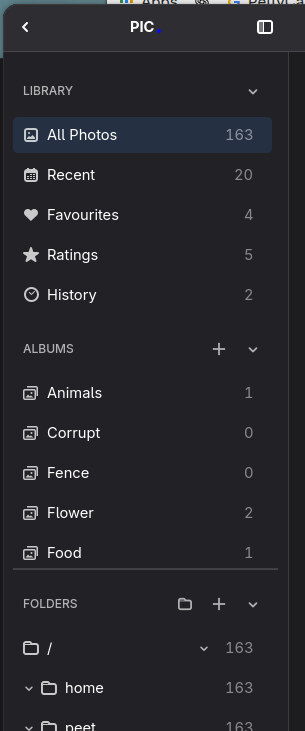

- The compact sidebar's glyphs and titles match the full sidebar.
- The gallery scrollbar is the same slim width as the sidebar's.
- The sidebar's Ratings views are independent of the toolbar rating filter. The toolbar rating is greyed out there, with a tooltip saying why.

## Rendering, export and RAW

- **One render pipeline** for the viewer, thumbnails, export, print, collage and the screensaver, so an edit looks the same everywhere.
- **Effects match at every size**: sharpen, smooth, grain, Old Photo and Newspaper are sized in source pixels, so a thumbnail or a small export looks like the full-size photo shrunk.
- **Faster exports**: JPEG export uses TurboJPEG (encoding about 342 ms → 59 ms per 12 MP photo), and tone and overlays run at the export size.
- **Faster Nikon RAW exports**: small exports of NEF files use a half-size develop (8 D800 NEFs at 2048 px: 17.4 s → 8.0 s), and exports that cannot use it skip the wasted unpack.
- **Blown highlights in Nikon RAW stay white** instead of turning magenta (or grey with halos in black-and-white looks). This applies in the viewer, the editor and export.
- Exports embed an sRGB profile with a fixed date, so exporting the same photo twice gives identical files.
- GPU Auto Colour uses the same neutral rule as the CPU.

## Viewer and performance

- **Large PNGs open faster**: 1:1 zoom reuses the full-size decode (598 ms → 39 ms), files are read in one go, and pixels are no longer copied on the main thread.
- Resizing opaque RGBA images skips the alpha step (6426 × 6384 PNG: 124 ms → 34 ms).
- The viewer keeps at most one full-size decode, for the photo in front, and frees it as soon as you move on.
- Alt+Left, Ctrl+Right and other arrow combinations no longer change the photo in the viewer.

## Quick edits for photos outside the library

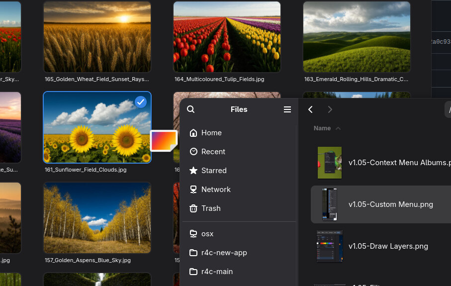

- Drag photos from the file manager onto the PIC window, or use **Open With PIC**, to open them in the viewer for a quick fix without adding them to the library (since v1.0.4). **Save Copy** writes the edited photo as `<name>_edit` next to the original, and the original is never touched.
- New in v1.0.5: they open in the redesigned editor with Draw, Text and Overlays layers. Closing one with the InfoBar's Edit toggle returns to the viewer, and InfoBar **Print** now works for them.

## Libraries, folders and scanning

- **Watched folders catch up** on changes made while PIC was closed, a drive was unmounted or watching was off. Subfolders are now watched as well, and new photos show up in the grid.
- **Libraries moved to another disk or machine** can be refreshed again: when the photos are still there, the new storage is recorded (#256).
- **RAW+JPEG pairs** never show both halves during a scan, even when the file names differ in letter case (IMG_1.NEF and img_1.jpg).
- Folder views rebuild in place after a scan, keeping the selected folder and scroll position, instead of adding new photos at the end as a second section.
- Stopping a scan rebuilds All Photos in order and rebuilds the folder tree with its counts.
- A rating-filtered view no longer fills with unrated photos during a scan.
- Switching library resets the session's rating filter (#263) and never shows the old library's photos, albums or a refresh still running for it.
- A launch that hands off to an already running PIC (for example the Flatpak) says so.

## Fixes

- Library counts update after moving photos to Trash.
- A session restored on History shows the History photos in History order.
- The Albums overview keeps following the browsing filters after album edits.
- Smart Album counts update after a folder favourite.
- Offline badges clear after a drive is remounted.
- The metadata panel comes back after Immersive Mode only if it was toggled on.
- Export works for every library photo, including one missing from the gallery's list.

## Under the hood

The window code continued its restructuring into small, tested modules, each the single owner of one job:

- **Browse scope**: one description of what is being browsed, used by every query.
- **Photo list pipeline**: one way to build a destination's photos.
- **Album list**: the one writer for the album surfaces.
- **Photo change fan-out**: one path for reporting a changed photo to every view.
- **Collection navigation**, the **scan view**, the **workspace session** (editor and collage), **keyboard dispatch** and the **metadata panel**.

`scripts/check-presentation-owners.sh` guards each of these. The test suite grew to about 1,400 tests, many of them written to fail on the old code first.
