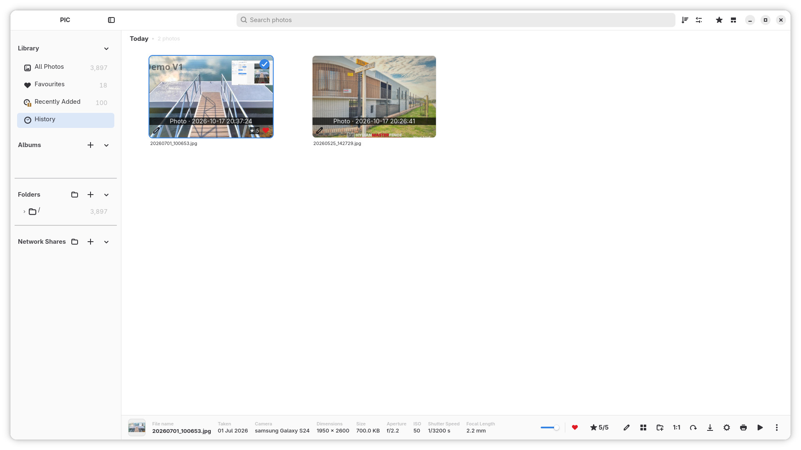
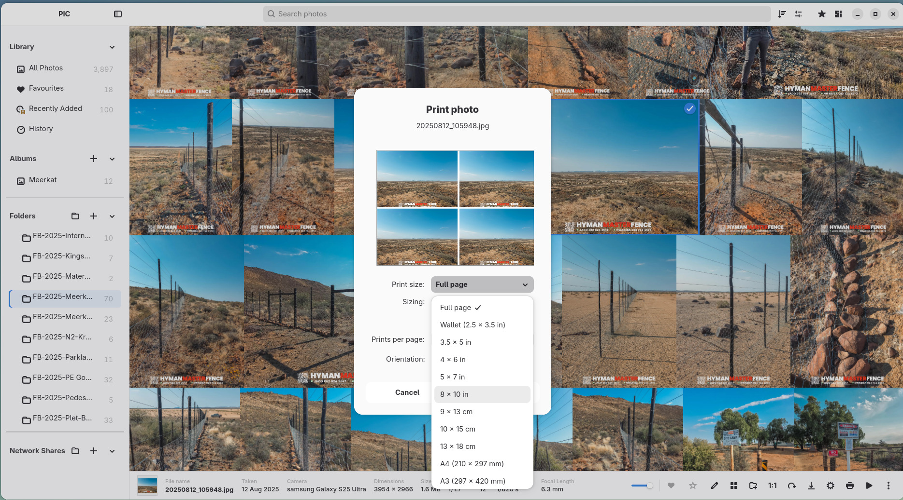
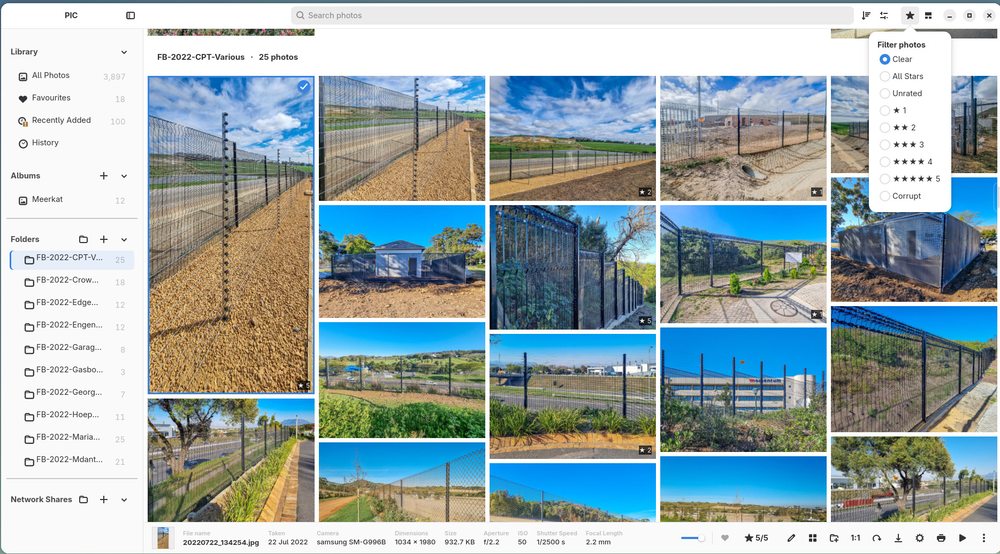
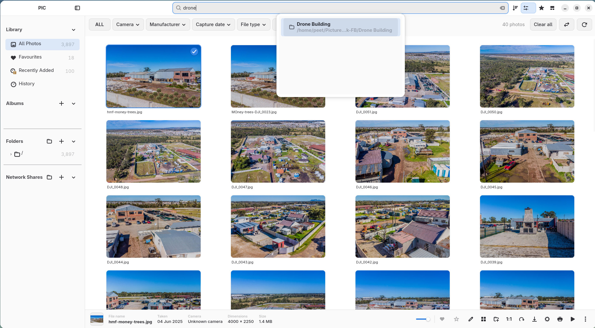
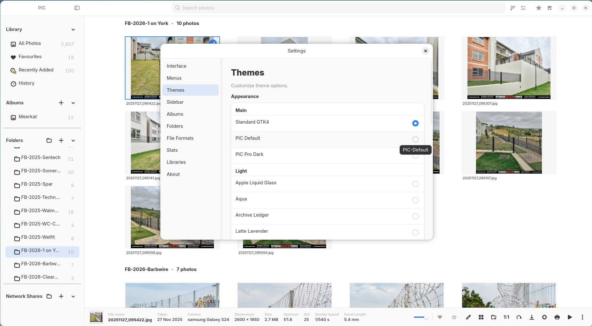
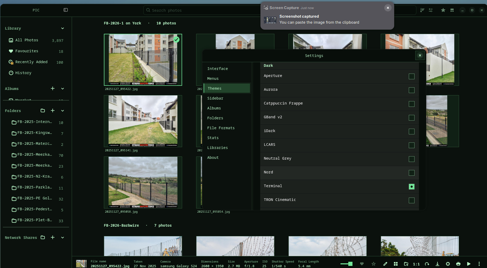
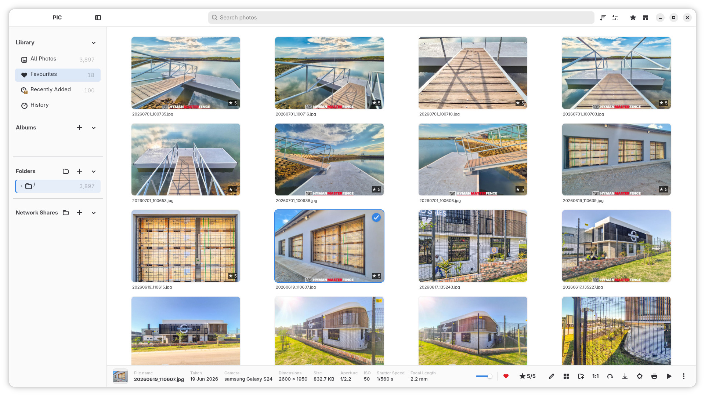
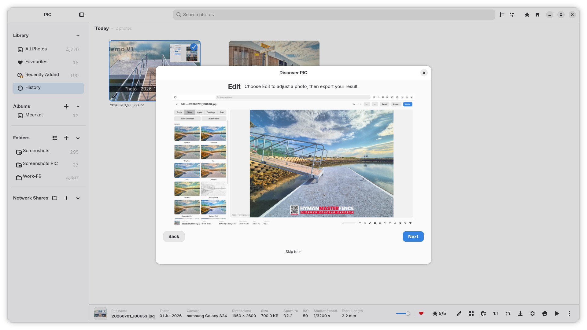

# PIC V1 media

Current documentation uses the JPG captures in `screenshots-V1/` and the [OS testing gallery](testingOS/README.md). Original screenshot dimensions are preserved; PNG captures were converted to JPEG at quality 92. Earlier screenshots and the older editor video are archived in `rc/` for historical release notes.

## Walkthrough

- [Normal-speed MP4](screenshots-V1/walkthrough-V1.mp4) — approximately 129 seconds.
- [2× MP4 for Reddit](screenshots-V1/walkthrough-V1-reddit-2x.mp4) — approximately 65 seconds.
- [Source MKV](screenshots-V1/walkthrough-V1.mkv).

Both MP4s preserve the actual source resolution of **1920×1080**, with H.264 video, AAC audio and fast-start playback. The requested “1980×1080” was interpreted as the source 1080p size. The 2× copy speeds up both picture and audio.

## Screenshot gallery

### 3 dots menu only

### add new album

### albums index

### collage create

### easter egg

### edit mode - add overlay

### edit mode - add text

### edit mode - crop

### edit mode - filters

### edit mode - tools

### edit mode tools with terminal theme

### export photo

### filter by ratings

### filter metadata panel

### grid metadata view

### history

### library index

### network shares-scan subnet

### network shares

### print

### ratings

### search

### settings - interface

### settings - multiple libraries

### settings - stats

### sidebar hidden

### sort by date taken

### sort by

### theme-PIC Dark-Official

### theme-PIC Default Official

### theme-lcars

### theme-nord

### theme-snow leopard

### theme-standard-gtk4

### theme-terminal

### view-folders

### watch folder

### albums bookshelf theme

### Welcome screen

### Tutorial screen

